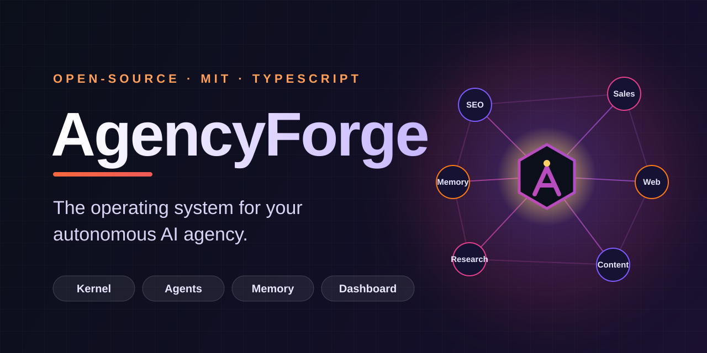
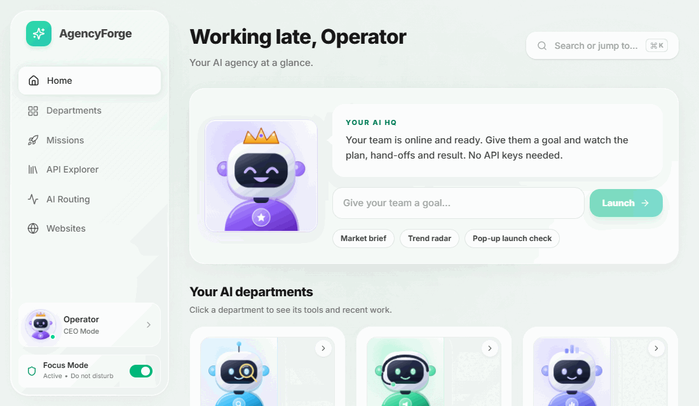
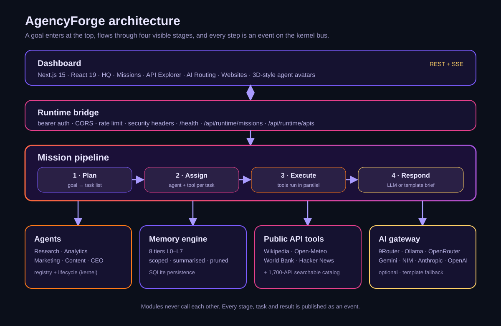
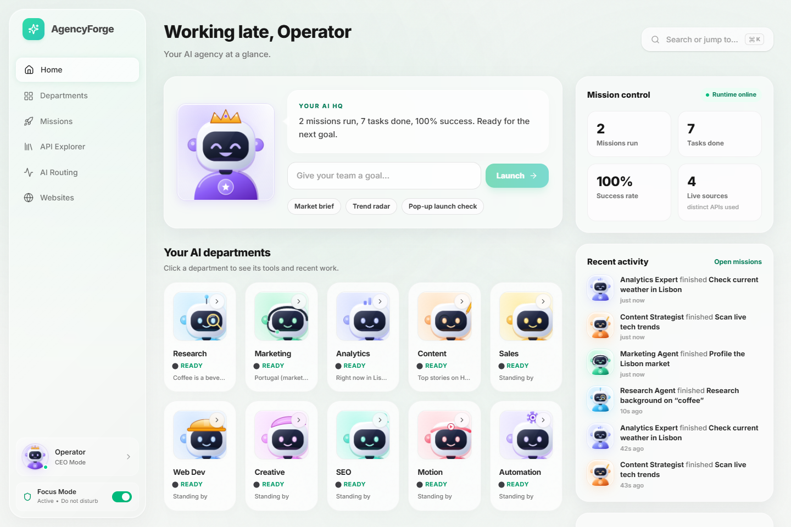
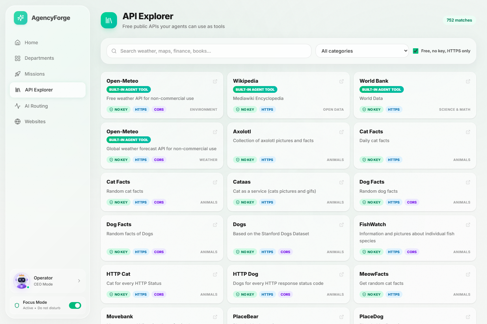

<div align="center">



<br/>

[](https://github.com/Rajeshkadali97/agencyforge/actions/workflows/ci.yml)
[](LICENSE)
[](https://nodejs.org)
[](https://www.typescriptlang.org)
[](#quick-start)
[](CONTRIBUTING.md)

**Give an AI team a goal and watch it plan, hand off work, call live data sources and write the brief. No API keys required.**

[Quick start](#quick-start) · [How missions work](#how-a-mission-works) · [API Explorer](docs/API_CATALOG.md) · [Architecture](#architecture) · [Docs](docs/HANDBOOK.md) · [Roadmap](docs/ROADMAP.md)

</div>

---

<p align="center">
  
</p>

## Why AgencyForge

Most agent frameworks hand you a loop and a prompt. You still have to build the part you actually want: a *team* with a planner, specialists, visible hand-offs, memory and a place to watch it all happen.

AgencyForge is that whole stack in one TypeScript monorepo, and it works on a fresh clone with **zero configuration**:

- **See the work.** Every goal runs through a visible `Plan → Assign → Execute → Respond` pipeline. Intermediate results are stored, not hidden.
- **Real data from day one.** Built-in agent tools call live, key-less public APIs (Wikipedia, Open-Meteo, World Bank, Hacker News). A searchable catalog of **1,700+ more** is one click away.
- **Honest by design.** When no LLM is configured, a template writer repeats tool output and says so. Every brief lists its sources.
- **Free-first AI routing.** Plug in a local gateway ([9Router](https://github.com/decolua/9router)), Ollama, OpenRouter, Gemini, NVIDIA NIM, Anthropic or OpenAI. Automatic failover; your keys never leave your machine.
- **Event-driven core.** Modules never call each other. Everything is an event on one bus, so every step is observable and extensible.
- **Production plumbing.** Bearer auth, CORS, rate limiting, security headers, SQLite persistence, health endpoint, OTLP tracing, secret scanning in CI.

## Quick start

**Requirements:** Node.js 20+ and [pnpm](https://pnpm.io) 10 (`corepack enable` is enough).

```bash
git clone https://github.com/Rajeshkadali97/agencyforge.git
cd agencyforge

pnpm install
pnpm build
pnpm doctor            # checks Node, build output, SQLite binding, ports, network

pnpm start:runtime     # RuntimeBridge on http://localhost:3001
pnpm start:dashboard   # Dashboard     on http://localhost:3000
```

Open <http://localhost:3000>, type a goal such as *"Plan an outdoor coffee pop-up launch in Lisbon and check the weather"*, and press **Launch**.

> [!TIP]
> Want an LLM to write the brief instead of the template? Run `npx 9router` (free multi-provider gateway on `localhost:20128`) or copy `.env.example` to `.env` and add any provider key. Nothing else changes.

### Docker

```bash
docker compose up --build
```

> [!NOTE]
> The Docker setup builds the whole workspace from the repository root. CI builds both images (`runtime` and `dashboard`) on every push.

## How a mission works

<p align="center">
  
</p>

1. **Plan.** The goal becomes a task list: background research on the topic, plus weather, market or trend tasks when the goal asks for them.
2. **Assign.** Each task goes to a department agent and a tool.
3. **Execute.** Tools run in parallel against live APIs. A failing tool is reported and the mission continues.
4. **Respond.** An executive brief is written by an LLM when one is reachable, otherwise by a template. You can copy it as Markdown.

Inspect any mission over HTTP, the same way the dashboard does:

```bash
curl -X POST http://localhost:3001/api/runtime/missions \
  -H 'Content-Type: application/json' \
  -d '{"goal":"Research the dental clinic market in Germany and brief me on tech trends"}'
```

Read [docs/MISSIONS.md](docs/MISSIONS.md) for the full API, the event names and how to add your own tool in five steps.

## The dashboard

<p align="center">
  
  
</p>

- **Headquarters** shows your departments, real mission statistics and live activity. Nothing on it is mock data.
- **Missions** runs the pipeline and shows each agent's work as it happens.
- **API Explorer** searches 1,700+ public APIs. Filter to *free, no key, HTTPS*. Built-in agent tools are flagged.
- **AI Routing** shows the provider chain, health and failovers.
- **Websites** generates site projects from a brief.

Agents are drawn as studio-lit, 3D-style vector avatars that react to their state (working, thinking, done, needs attention). They are plain SVG: no image files, no licensing questions.

## Architecture

| Package | Path | What it does |
|---|---|---|
| `@agencyforge/kernel` | [`kernel/`](kernel) | Event bus, task graph, agent registry, DI container, executor |
| `@agencyforge/runtime` | [`runtime/`](runtime) | Bootstrap, missions, workflow engine, RuntimeBridge (REST + SSE), AI routing, persistence |
| `@agencyforge/memory-engine` | [`memory-engine/`](memory-engine) | Eight-tier memory with search, scoping and summarisation |
| `@agencyforge/research` | [`research/`](research) | Company discovery, competitor, SEO and technology analysis |
| `@agencyforge/revenue-engine` | [`revenue-engine/`](revenue-engine) | Lead sourcing adapters, scoring, outreach pipeline |
| `@agencyforge/website-builder` | [`website-builder/`](website-builder) | Brief → site plan → generated pages |
| `agencyforge-dashboard` | [`dashboard/`](dashboard) | Next.js 15 / React 19 command centre |

Deep dives: [`docs/architecture`](docs/architecture/README.md). Formal specs (kernel, task graph, memory, agent contract, global rules): [`docs/specs`](docs/specs).

## Configuration

Nothing is required to boot. Copy [`.env.example`](.env.example) to `.env` to change defaults.

| Variable | Purpose |
|---|---|
| `NINE_ROUTER_URL` | Local AI gateway (default `http://localhost:20128/v1`) |
| `OPENROUTER_API_KEY`, `GEMINI_API_KEY`, `NIM_API_KEY`, `ANTHROPIC_API_KEY`, `OPENAI_API_KEY` | Direct provider fallbacks |
| `RUNTIME_API_KEY` | Require `Authorization: Bearer …` on runtime endpoints. **Set in production**, also in the dashboard server env: it proxies calls and keeps the key off the browser |
| `CORS_ORIGIN` | Allowed dashboard origin. **Set explicitly in production.** |
| `AGENCYFORGE_DB_PATH` | SQLite file for events, state and memory |
| `NEXT_PUBLIC_OPERATOR_NAME` | Name shown in the dashboard greeting |

Secrets are read from the environment only. `.env` files are git-ignored and CI runs a secret scan on every push.

## Project status

AgencyForge is **v0.2 alpha**. Specifically:

| Area | State |
|---|---|
| Kernel, event bus, workflow engine, runtime bridge, AI failover, memory engine, persistence | Solid. Covered by automated tests |
| Missions pipeline and four built-in tools | Working. Rule-based planner (no LLM planner yet); missions held in memory |
| Dashboard: HQ, Missions, API Explorer, AI Routing, Websites | Working. Reads real data from the runtime |
| Research, revenue and website engines | Early. Adapters that call paid or restricted APIs need your keys and your compliance review |
| Voice, multi-node scaling, Postgres | Not implemented. See [Known limitations](docs/guides/KNOWN_LIMITATIONS.md) |

Older internal status reports are kept in [`docs/archive`](docs/archive) for history only. Please read [Responsible use](docs/RESPONSIBLE_USE.md) before building outreach on top of this.

## Contributing

Ideas, issues and pull requests are welcome. Start with [CONTRIBUTING.md](CONTRIBUTING.md), and adding a mission tool is a great first change: [docs/MISSIONS.md](docs/MISSIONS.md#add-a-tool). Ideas are listed in [docs/GOOD_FIRST_ISSUES.md](docs/GOOD_FIRST_ISSUES.md). Please follow the [Code of Conduct](CODE_OF_CONDUCT.md). Report vulnerabilities privately as described in [SECURITY.md](SECURITY.md).

## Acknowledgements

- The staged plan → select → execute → respond idea follows the [HuggingGPT / JARVIS](https://github.com/microsoft/JARVIS) line of research.
- The API catalog is generated from [public-apis/public-apis](https://github.com/public-apis/public-apis) (MIT).
- Live data comes from Wikipedia, Open-Meteo, the World Bank and Hacker News under their respective terms. See [THIRD_PARTY_NOTICES.md](THIRD_PARTY_NOTICES.md).

## License

[MIT](LICENSE) © AgencyForge contributors.
