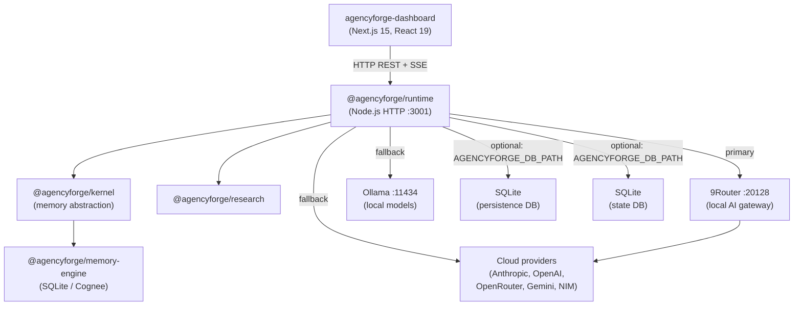

# 01 — System Overview

## What AgencyForge is

AgencyForge is a TypeScript/Node.js **agentic runtime** — a server process that orchestrates AI-powered agents, workflows, and business pipelines. It exposes a REST+SSE API consumed by the Next.js dashboard, and routes all AI inference through a local 9Router gateway before falling back to cloud providers.

It is **not** a multi-tenant SaaS platform. It is a single-instance, self-hosted runtime for one operator.

---

## Monorepo structure

```
AgencyForge/
├── runtime/          @agencyforge/runtime         Core runtime (Node.js, TypeScript)
├── dashboard/        agencyforge-dashboard        Next.js 14 web UI
├── kernel/           @agencyforge/kernel          Memory abstraction kernel
├── memory-engine/    @agencyforge/memory-engine   Pluggable memory backends
├── research/         @agencyforge/research        Research agent package
├── revenue-engine/   (nested workspace)       Revenue pipeline agents
└── docs/             Documentation
```

**Workspace manager:** pnpm 9 (`pnpm-workspace.yaml`).

---

## Package dependency graph



**Key:** Dashboard communicates with runtime **only over HTTP**. No shared in-process state.

---

## Internal component map (runtime)

```
runtime/src/
├── bootstrap/        RuntimeBootstrap — orchestrates startup wiring
├── bridge/           RuntimeBridge (HTTP server :3001)
│                     StreamTokenManager (SSE HMAC tokens)
├── health/           HealthManager, HealthServer (:3002 loopback-only)
├── coordinator/      RuntimeCoordinator — goal execution entry point
├── workflow/         WorkflowEngine (types + IWorkflowEngine)
│                     WorkflowEngineImpl (DAG executor)
├── agent/            IAgentRuntime, AgentRegistry, AgentOrchestrator
│   └── impl/         ResearchAgent (built-in)
├── events/           EnhancedEventBus (wildcard pub/sub, 10k history)
├── contracts/        RuntimeEvent types, event type constants (40+)
├── ai/               AIService (fallback chain), ProviderFactory
│   ├── providers/    ninerouter, ollama, openrouter, gemini, nim
│   └── providers/optional/  anthropic, openai
├── providers/        AIProviderRouter (legacy; dashboard health display only)
├── persistence/      PersistenceService (SQLite event + snapshot store)
├── state/            RuntimeStateStore, SQLiteRuntimeStateStore
├── bindings/         Adapters: dashboard, memory, kernel, character, voice
├── shared-context/   SharedContextManager (live in-memory state)
├── plugins/          PluginRegistry, manifests (firecrawl, flowise, paperclip, research)
├── observability/    ObservabilityService, OTLPExporter (zero-dep OTLP)
├── integrations/     BrowserAgent, LeadScorerAgent, KnowledgeAgent, FrontendCodingAgent
├── recovery/         ErrorRecovery
├── scheduler/        Scheduler (node-cron wrapper)
├── tools/            ToolExecutionEngine
├── config/           Configuration, RuntimeConfig, defaultConfig
├── interfaces/       ILogger, IConfiguration, IEventBus
├── context/          ExecutionContext, ExecutionContextFactory
├── container/        ServiceContainer (DI)
└── utils/            CancellationToken, ConsoleLogger
```

---

## Two AI provider stacks — critical distinction

There are **two separate AI provider implementations** in the codebase. This is a historical artifact and a known ambiguity.

| Stack | Location | Used by | Notes |
|---|---|---|---|
| **AIService + BaseAIProvider** | `runtime/src/ai/` | `RuntimeBridge /api/runtime/chat`, agent execution | Primary path. 9Router first, 10s timeout, stream timeout, fallback chain |
| **AIProviderRouter + AIProvider (abstract)** | `runtime/src/providers/AIProviderRouter.ts` | `GET /api/ai/routing` (health display) | Legacy. Exposes provider health to dashboard. Does not execute real inference in production |

**When adding new AI features:** use the `ai/` stack exclusively. The `providers/` stack is read-only for health dashboarding.

---

## Design principles (as observed in code, not aspirational)

**Event-driven interior.** Every state change publishes a `RuntimeEvent` to `EnhancedEventBus`. Subsystems subscribe to events; they do not call each other directly.

**Opt-in persistence.** `PersistenceService` only activates when `AGENCYFORGE_DB_PATH` is set. All core functionality works in-memory with zero disk requirements.

**Provider fallback chain.** AI calls try providers in order: 9Router → Ollama → OpenRouter → Gemini → NIM → Anthropic → OpenAI. Any provider that throws moves to the next. Errors are logged but not surfaced until all fail.

**Plugin isolation.** Plugin failures are caught at activation time in `createRuntime()`. A broken plugin logs a warning and is skipped; it cannot prevent startup.

**Auth at the edge.** All authentication and rate-limiting is enforced in `RuntimeBridge._handleRequest()` before routing. Internal subsystems receive pre-authenticated requests.

**No framework HTTP.** The runtime uses Node.js built-in `http.createServer` — no Express, Fastify, or Hono. Route matching is done with `if/else` in `_handleRequest`.

---

## Technology stack

| Layer | Technology | Version |
|---|---|---|
| Language | TypeScript | 5.3 |
| Runtime | Node.js | 20 LTS+ |
| HTTP server | Node.js `http` (no web framework) | built-in |
| Dashboard | Next.js | 15.1 |
| Dashboard UI | React 19, Radix UI, Tailwind CSS | — |
| Animations | Framer Motion | 11.x |
| Database | SQLite via `better-sqlite3` | 11.x |
| Test runner | Vitest | 1.x |
| Package manager | pnpm | 9 |
| Observability | OTLP HTTP/JSON (zero external deps) | — |
| Scheduling | node-cron | 4.x |
| Web scraping | Firecrawl SDK | 4.x |
