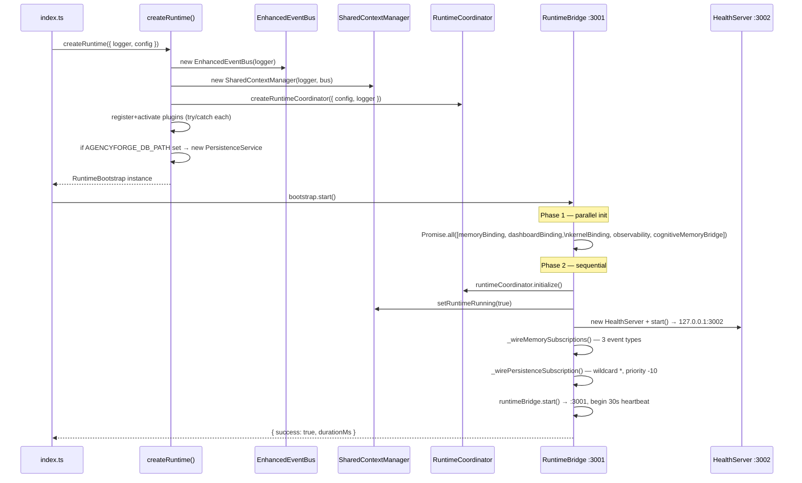
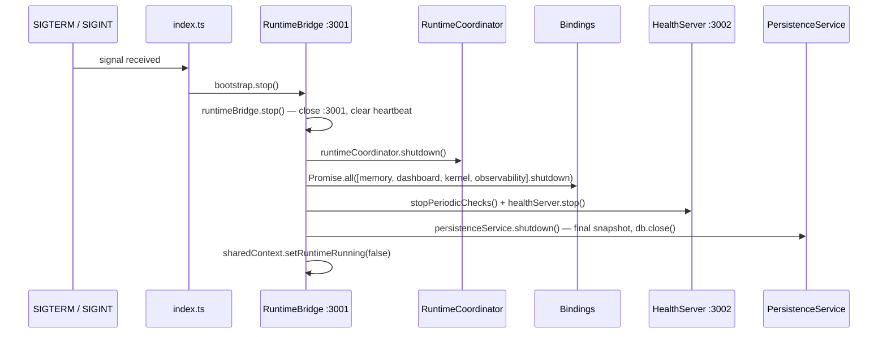

# 02 — Runtime Lifecycle

## Entry points

| Entry point | File | Used for |
|---|---|---|
| `node dist/index.js` | `runtime/src/index.ts` | Production |
| `pnpm dev` | same, via ts-node | Development |
| `createRuntime(opts)` | `runtime/src/bootstrap/RuntimeBootstrap.ts` | Tests, programmatic |

All three converge on `createRuntime()` followed by `bootstrap.start()`.

---

## Bootstrap sequence



### Wiring order detail

1. All bindings initialize **in parallel** — none depend on each other at init time.
2. `RuntimeCoordinator.initialize()` runs after bindings.
3. `_wireMemorySubscriptions()` subscribes cognitive memory to `research.completed`, `lead.scored`, `proposal.generated`.
4. `_wirePersistenceSubscription()` subscribes to `*` (all events) at priority `-10` (runs last among subscribers).
5. `runtimeBridge.start()` opens port 3001 last — the system is only externally reachable once everything above is wired.

---

## Shutdown sequence



**Current gap:** No SIGTERM handler in `index.ts` calls `bootstrap.stop()`. The process exits on signal without graceful shutdown. This is a known post-RC1 item.

---

## Subsystem construction dependencies

```
EnhancedEventBus          ← no dependencies; created first
SharedContextManager      ← needs EnhancedEventBus
DashboardBinding          ← needs EnhancedEventBus
KernelBinding             ← needs EnhancedEventBus
ObservabilityService      ← needs EnhancedEventBus
MemoryBinding             ← needs EnhancedEventBus + SharedContextManager
CognitiveMemoryBridge     ← constructed with logger; engine wired lazily
HealthManager             ← no dependencies
RuntimeCoordinator        ← creates its OWN internal EnhancedEventBus (see note)
RuntimeBridge             ← needs all bindings + SharedContextManager + ObservabilityService
HealthServer              ← needs HealthManager
PersistenceService        ← opens SQLite at construction time (not deferred)
PluginRegistry            ← global singleton; stateless until activate()
```

**Important:** `RuntimeCoordinator` creates its **own** `EnhancedEventBus` separate from the bootstrap-level bus. Coordinator-internal events (workflow lifecycle, task lifecycle, agent lifecycle) are on the coordinator's bus. Dashboard/character/voice events are on the bootstrap bus. These two buses do not share events.

---

## Environment variables that affect startup

| Variable | Default | Effect |
|---|---|---|
| `RUNTIME_API_KEY` | unset | If set, enables bearer auth on all endpoints |
| `STREAM_TOKEN_SECRET` | required for SSE auth | HMAC key for short-lived stream tokens |
| `AGENCYFORGE_DB_PATH` | unset | If set, activates SQLite persistence |
| `RUNTIME_PORT` | 3001 | RuntimeBridge listen port |
| `HEALTH_PORT` | 3002 | HealthServer listen port |
| `NINE_ROUTER_URL` | `http://localhost:20128/v1` | 9Router base URL |
| `OTEL_EXPORTER_OTLP_ENDPOINT` | unset | If set, OTLP traces exported every 30s |
| `VITEST` | unset | If set, ports assigned as 0 (OS-chosen) to avoid conflicts in parallel tests |

---

## Lifecycle invariants

- `RuntimeBootstrap.start()` is **not idempotent** — calling twice opens HealthServer twice and fails on second `listen`.
- `RuntimeBridge.start()` **is** idempotent — guarded by `this.running` flag set before `await listen()`.
- `PersistenceService` opens SQLite immediately in its constructor. If the path is invalid, `createRuntime()` throws.
- Plugins: activation failures are caught; a broken plugin warns and is skipped, never crashing the runtime.
