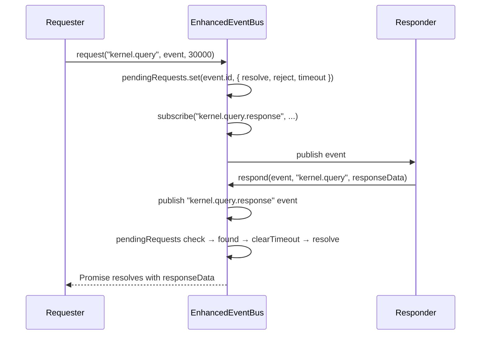

# 03 — Event System

## Overview

`EnhancedEventBus` is the central nervous system of the runtime. All inter-subsystem communication goes through it. Subsystems never import and call each other directly.

File: `runtime/src/events/EnhancedEventBus.ts`

---

## Internal data structures

```typescript
interface EventSubscription {
  id: string;              // "sub_1", "sub_2", ...
  eventType: string | string[];  // exact type, array, or '*' wildcard
  handler: EventHandler;
  once?: boolean;          // auto-unsubscribe after first fire
  priority: number;        // higher = fires first; default 0
  label?: string;          // debug label
  active: boolean;         // false = paused or unsubscribed
  createdAt: Date;
}

interface EventLogEntry {
  event: RuntimeEvent;
  dispatchedAt: Date;
  handlerCount: number;
  errors: Array<{ subscriptionId: string; error: string }>;
  durationMs: number;
}
```

## API surface

| Method | Signature | Notes |
|---|---|---|
| `publish` | `(event) → void` | Fans out to all matching subscribers |
| `broadcast` | `(event) → void` | Alias for `publish` |
| `subscribe` | `(type, handler, opts?) → subId` | Returns subscription ID for later unsub |
| `unsubscribe` | `(subId) → boolean` | Removes subscription; sets `active=false` first |
| `pauseSubscription` | `(subId) → boolean` | Sets `active=false`; keeps subscription in map |
| `resumeSubscription` | `(subId) → boolean` | Sets `active=true` |
| `request` | `(type, event, timeoutMs?) → Promise<T>` | Pub/sub RPC pattern; 30s default timeout |
| `respond` | `(requestEvent, type, response, error?) → void` | Sends `type.response` event back |
| `replayEvents` | `(type, handler, fromDate?) → void` | Calls handler for past events from history |
| `getHistory` | `(type?, limit?) → RuntimeEvent[]` | Read last N events of given type |
| `getEventLog` | `(limit?) → EventLogEntry[]` | Diagnostic dispatch log (1k cap) |
| `getSubscriptions` | `() → …[]` | List all active subscriptions |
| `getStats` | `() → {…}` | totalSubs, activeSubs, totalEvents, recentErrors |
| `clearHistory` | `() → void` | Empties history array |

---

## Wildcard matching

`getMatchingSubscriptions` iterates all subscriptions per publish. Matching rules:

```
sub.eventType === '*'         → matches everything
Array.isArray(sub.eventType) → matches if eventType in array
sub.eventType === event.type  → exact string match
```

Matched subscriptions are sorted by `priority` descending before dispatch.

---

## Handler error isolation

Handlers are called via `Promise.resolve(sub.handler(event)).catch(...)`. Async errors are caught and logged; they do **not** stop other handlers from running. Sync throws are caught in the outer `try/catch` and logged to `errors`. Either way, all handlers run.

---

## History cap behavior

```
publish called →
  history.push(event)
  if history.length > maxHistorySize (10000):
    history.shift()   ← O(n) — shifts entire array
```

O(n) shift at cap. At current event rates (< 500k/day projected), this cap is hit only under very high load. Acceptable for RC1; replace with circular buffer for future scaling.

---

## Request/Response pattern

Used when one subsystem needs a synchronous-style answer from another via the bus.



Timeout fires if no `.response` event arrives within `timeoutMs`. Rejected with `Error("Request timeout: {type}")`.

---

## Two event bus instances (critical!)

```
RuntimeBootstrap creates:
  EnhancedEventBus (bootstrap bus)
    ← dashboard events
    ← character events
    ← voice events
    ← memory subscriptions (3 types)
    ← persistence subscription (wildcard *)

RuntimeCoordinator creates internally:
  EnhancedEventBus (coordinator bus)
    ← workflow lifecycle events
    ← task lifecycle events
    ← agent lifecycle events
```

Events on the coordinator bus **never reach** the bootstrap bus and vice versa. If a future feature needs cross-bus events, use an explicit bridge subscription.

---

## Full event catalog

Source: `runtime/src/contracts/types.ts` → `RuntimeEventTypes`

### Goal / Execution

| Event type | Payload fields |
|---|---|
| `goal.submitted` | `goalId, objective, userId, priority` |
| `goal.completed` | `goalId, result, durationMs` |
| `goal.failed` | `goalId, error, durationMs` |

### Workflow

| Event type | Payload fields |
|---|---|
| `workflow.started` | `workflowId, name, stepCount` |
| `workflow.step.started` | `workflowId, stepId, stepName` |
| `workflow.step.completed` | `workflowId, stepId, result` |
| `workflow.step.failed` | `workflowId, stepId, error` |
| `workflow.completed` | `workflowId, result, durationMs` |
| `workflow.failed` | `workflowId, error, durationMs` |
| `workflow.cancelled` | `workflowId, reason` |
| `checkpoint.approval.required` | `workflowId, stepId, description, timeout` |
| `checkpoint.approved` | `workflowId, stepId, approved` |

### Task

| Event type | Payload fields |
|---|---|
| `task.created` | `taskId, objective, agentId` |
| `task.started` | `taskId, agentId` |
| `task.completed` | `taskId, result, durationMs` |
| `task.failed` | `taskId, error, durationMs` |

### Agent

| Event type | Payload fields |
|---|---|
| `agent.registered` | `agentId, name, capabilities` |
| `agent.started` | `agentId, taskId` |
| `agent.completed` | `agentId, taskId, result` |
| `agent.failed` | `agentId, taskId, error` |
| `agent.message` | `agentId, role, content` |

### Research

| Event type | Payload fields |
|---|---|
| `research.started` | `researchId, query` |
| `research.completed` | `researchId, results, sources` |
| `research.failed` | `researchId, error` |

### Revenue / Lead

| Event type | Payload fields |
|---|---|
| `lead.identified` | `leadId, source, data` |
| `lead.scored` | `leadId, score, rationale` |
| `proposal.generated` | `proposalId, leadId, content` |
| `revenue.opportunity` | `opportunityId, value, confidence` |

### Voice / Character

| Event type | Payload fields |
|---|---|
| `voice.command` | `command, confidence, transcript` |
| `character.emotion.changed` | `character, emotion, intensity` |
| `character.animation.trigger` | `character, animation` |

### Dashboard / Notification

| Event type | Payload fields |
|---|---|
| `dashboard.notification` | `message, level, category` |
| `dashboard.update` | `section, data` |
| `system.health.check` | `componentId, status, details` |
| `system.error` | `error, component, severity` |
| `system.shutdown` | `reason` |

---

## Pub/sub patterns used in codebase

**Fan-out:** `RuntimeBridge` subscribes to `Object.values(RuntimeEventTypes)` (all types) and forwards each to SSE clients.

**Priority ordering:** `PersistenceService` subscribes to `*` at priority `-10` — runs last after all domain handlers, ensuring persistence sees the final state.

**One-shot:** `WorkflowEngineImpl` uses `{ once: true }` on approval response subscriptions.

**Replay:** Dashboard binding replays recent events on new SSE connections via `replayEvents()`.
