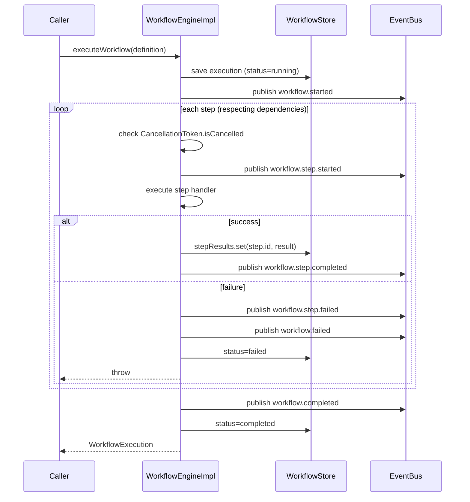

# 05 — Workflow Engine

## Files

| File | Role |
|---|---|
| `runtime/src/workflow/WorkflowEngine.ts` | Types, interfaces, `InMemoryWorkflowStore` |
| `runtime/src/workflow/WorkflowEngineImpl.ts` | DAG executor |

---

## Core types

```typescript
type WorkflowStatus = 'pending' | 'running' | 'completed' | 'failed' | 'cancelled';
type StepStatus     = 'pending' | 'running' | 'completed' | 'failed' | 'skipped' | 'cancelled';
type StepType       = 'sequential' | 'parallel' | 'conditional' | 'approval' | 'retry';

interface WorkflowStep {
  id: string;
  name: string;
  type: StepType;
  handler?: (context: WorkflowContext) => Promise<StepResult>;
  retryPolicy?: RetryPolicy;
  approvalConfig?: ApprovalConfig;
  condition?: (context: WorkflowContext) => boolean;
  parallelSteps?: WorkflowStep[];
  dependencies?: string[];     // step IDs that must complete first
}

interface RetryPolicy {
  maxAttempts: number;
  backoffMs: number;
  backoffMultiplier?: number;
}

interface ApprovalConfig {
  description: string;
  timeoutMs: number;
  requiredApprovers?: string[];
}

interface WorkflowDefinition {
  id: string;
  name: string;
  steps: WorkflowStep[];
  cancellationToken?: CancellationToken;
}

interface WorkflowExecution {
  id: string;
  workflowId: string;
  status: WorkflowStatus;
  stepResults: Map<string, StepResult>;
  startedAt: Date;
  completedAt?: Date;
  error?: string;
}
```

---

## Step types

### sequential

Steps run in definition order. Each step waits for the previous. Default type.

### parallel

`parallelSteps[]` run concurrently via `Promise.all`. Enclosing step completes when all sub-steps complete. Any failure fails the whole group.

### conditional

`condition(context)` evaluated at runtime. Returns `false` → step skipped (status `skipped`). Handler not called.

### approval

Pauses execution until an external approval arrives via `POST /api/runtime/approve`. Uses the **settle pattern** to safely resolve across three concurrent sources (timeout, event, cancellation):

```typescript
let settled = false;
function settle(approved: boolean | null, reason?: string) {
  if (settled) return;          // idempotent — only first call wins
  settled = true;
  clearTimeout(timeoutHandle);
  cancelUnsubscribe?.();        // remove CancellationToken listener
  eventBus.unsubscribe(subId); // remove event subscription
  if (approved === null) reject(new CancellationError(reason));
  else resolve({ approved });
}

const subId = eventBus.subscribe('checkpoint.approved', (evt) => {
  if (evt.payload.stepId === step.id) settle(evt.payload.approved);
}, { once: true });

const timeoutHandle = setTimeout(() => settle(false, 'timeout'), config.timeoutMs);
const cancelUnsubscribe = cancellationToken?.onCancelled(() => settle(null, 'cancelled'));
```

### retry

Wraps another step handler, re-running it on failure with exponential backoff. `handleRetry()` always returns `false` — retries live in `executeWithRetry()`.

---

## DAG execution flow



---

## Dependency resolution

Steps with `dependencies: ['stepA', 'stepB']` do not start until all named steps have completed. Steps without `dependencies` can run freely within a `type:'parallel'` group.

---

## Cancellation

`WorkflowDefinition.cancellationToken` carries a `CancellationToken`. The engine checks `token.isCancelled` before each step. Approval steps call `token.onCancelled()` which returns an unsubscribe function for cleanup.

```typescript
class CancellationToken {
  get isCancelled(): boolean
  cancel(reason?: string): void      // fires all listeners
  onCancelled(listener): () => void  // returns unsubscribe fn
}
```

---

## Storage: InMemoryWorkflowStore

All workflow state is **in-memory**. No persistence layer for workflows.

```typescript
class InMemoryWorkflowStore {
  private executions: Map<string, WorkflowExecution>
  save(execution): void
  get(id): WorkflowExecution | undefined
  list(workflowId?): WorkflowExecution[]
  delete(id): boolean
}
```

**Consequence:** All in-progress workflows are lost on process restart. This is a documented RC1 limitation.

---

## Known limitations (RC1)

| Limitation | Impact | Post-RC1 path |
|---|---|---|
| No workflow persistence | In-progress workflows lost on restart | Persist `WorkflowExecution` to SQLite |
| No workflow queue | No back-pressure for concurrent workflows | Queue backing for `InMemoryWorkflowStore` |
| `Promise.all` on parallel steps | One failure kills all siblings | Switch to `Promise.allSettled` with per-step failure policy |
| Recommended max 20 concurrent, 50 steps/workflow | In-memory DAG; no queue backing | Redis-backed store for horizontal scaling |
