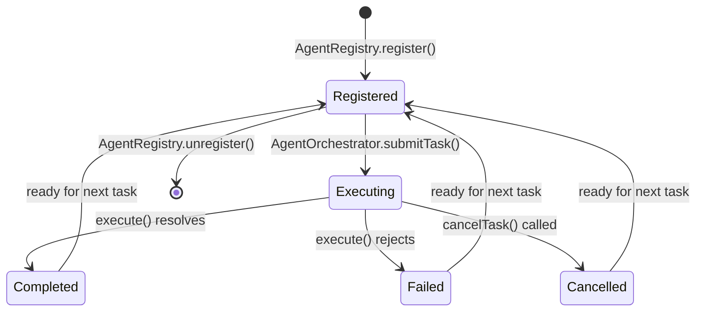
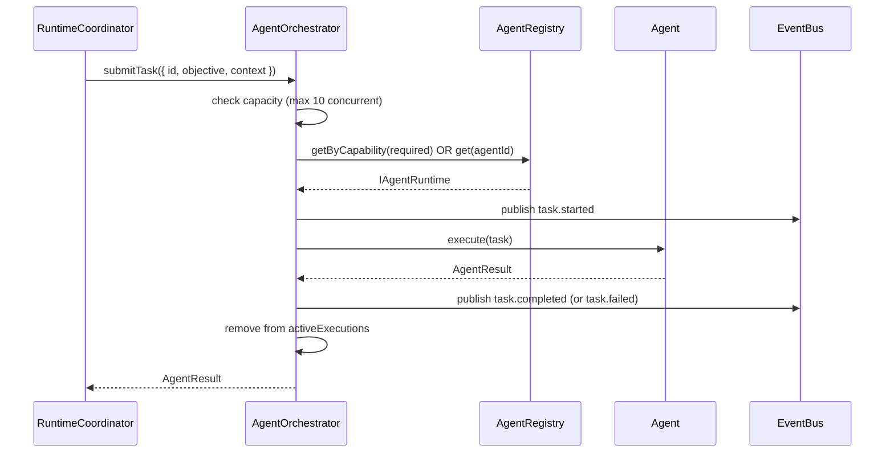

# 06 — Agent Lifecycle

## Files

| File | Role |
|---|---|
| `runtime/src/agent/IAgentRuntime.ts` | Agent contract interface |
| `runtime/src/agent/AgentRegistry.ts` | Global agent registry |
| `runtime/src/agent/AgentOrchestrator.ts` | Concurrency-limited dispatcher |
| `runtime/src/agent/impl/ResearchAgent.ts` | Built-in research agent |
| `runtime/src/integrations/` | BrowserAgent, LeadScorerAgent, KnowledgeAgent, FrontendCodingAgent |

---

## IAgentRuntime interface

```typescript
interface IAgentRuntime {
  readonly id: string;
  readonly name: string;
  readonly capabilities: string[];
  isAvailable(): boolean;
  execute(task: AgentTask): Promise<AgentResult>;
  cancel?(taskId: string): Promise<void>;
}

interface AgentTask {
  id: string;
  objective: string;
  context?: Record<string, unknown>;
  cancellationToken?: CancellationToken;
}

interface AgentResult {
  taskId: string;
  success: boolean;
  output?: unknown;
  error?: string;
  durationMs: number;
}
```

---

## AgentRegistry

Global singleton. Agents register themselves; the orchestrator queries by capability.

```typescript
class AgentRegistry {
  private agents: Map<string, IAgentRuntime>

  register(agent: IAgentRuntime): void
  unregister(id: string): void
  get(id: string): IAgentRuntime | undefined
  getByCapability(capability: string): IAgentRuntime[]
  list(): IAgentRuntime[]
}
```

Registration happens at bootstrap time in `createRuntime()` or via plugin activation.

---

## AgentOrchestrator

File: `runtime/src/agent/AgentOrchestrator.ts`

Controls concurrency and dispatches tasks to registered agents.

```typescript
class AgentOrchestrator {
  private maxConcurrentTasks = 10
  private activeAssignments: Map<string, string>           // taskId → agentId
  private activeExecutions: Map<string, Promise<AgentResult>>  // taskId → Promise

  async submitTask(task: AgentTask, agentId?: string): Promise<AgentResult>
  async cancelTask(taskId: string): Promise<void>
  getActiveTaskCount(): number
  isAtCapacity(): boolean
}
```

When `activeExecutions.size >= maxConcurrentTasks`, `submitTask` throws `Error('Orchestrator at capacity')`. Callers must implement their own queue or back-off.

---

## Agent lifecycle state machine



---

## Task dispatch sequence



---

## Built-in agents

### ResearchAgent

File: `runtime/src/agent/impl/ResearchAgent.ts`

Uses `@agencyforge/research` package. Accepts `objective` as a research query. Returns structured research results with sources.

Capabilities: `['research', 'web-search', 'information-retrieval']`

### Integration agents (`runtime/src/integrations/`)

| Agent | Capabilities | Notes |
|---|---|---|
| `BrowserAgent` | `['browser', 'web-automation']` | Headless browser tasks |
| `LeadScorerAgent` | `['lead-scoring', 'crm']` | Revenue pipeline integration |
| `KnowledgeAgent` | `['knowledge-base', 'qa']` | Knowledge retrieval |
| `FrontendCodingAgent` | `['code-generation', 'frontend']` | UI code generation |

---

## EventBus events from agent subsystem

| Event | When |
|---|---|
| `agent.registered` | `AgentRegistry.register()` called |
| `task.created` | `submitTask()` called |
| `task.started` | Execution begins |
| `task.completed` | `execute()` resolves successfully |
| `task.failed` | `execute()` rejects |
| `agent.message` | Agent emits intermediate message |

---

## Adding a new agent

1. Implement `IAgentRuntime` — set `id`, `name`, `capabilities` as readonly.
2. Implement `execute(task): Promise<AgentResult>`. Honor `task.cancellationToken` if provided.
3. Register with `AgentRegistry.register(instance)` in bootstrap or plugin `activate()`.
4. Orchestrator dispatches via capability matching automatically.
