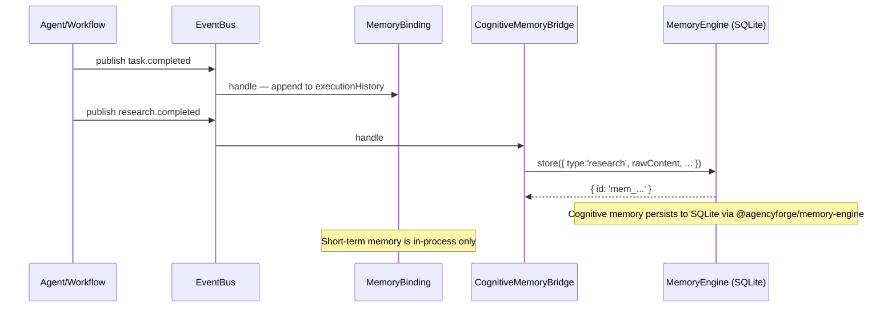

# 07 — Memory System

## Overview

AgencyForge has two distinct memory layers:

| Layer | File | Purpose |
|---|---|---|
| **MemoryBinding** | `runtime/src/bindings/memory/MemoryBinding.ts` | Short-term in-process key/value + execution history |
| **CognitiveMemoryBridge** | `runtime/src/bindings/memory/CognitiveMemoryBridge.ts` | Long-term semantic memory via `@agencyforge/memory-engine` |

These are separate systems. MemoryBinding is always active; CognitiveMemoryBridge is lazy — its engine is wired at runtime when cognitive storage is needed.

---

## Package dependency chain

```
runtime
  → @agencyforge/kernel          (memory abstraction layer; lodash dep)
      → @agencyforge/memory-engine  (pluggable backend; better-sqlite3 dep)
```

---

## MemoryBinding (short-term)

### Data structures

```typescript
interface MemoryEntry {
  id: string;
  key: string;
  value: unknown;
  scope: string;       // e.g. 'agent', 'workflow', 'global'
  createdAt: string;
  updatedAt: string;
  accessCount: number;
}

interface MemoryBindingConfig {
  maxMemoryEntries?: number;   // default 1000
  maxHistoryEntries?: number;  // default 500
}
```

### Storage

```typescript
private memory: Map<string, MemoryEntry>   // key → entry
private executionHistory: Array<{
  taskId: string;
  agentId: string;
  timestamp: string;
  result: string;    // 'FAILED: ...' prefix on failures
}>
```

Both are in-process only. Lost on restart.

### Event subscriptions

MemoryBinding subscribes to two events at `initialize()`:

| Event | Action |
|---|---|
| `task.completed` | Appends `{ taskId, agentId, timestamp, result }` to executionHistory |
| `task.failed` | Appends `{ taskId, agentId, timestamp, result: 'FAILED: ...' }` |

History is capped at `maxHistoryEntries` (500) via `slice(-N)`. Memory entries capped at `maxMemoryEntries` (1000) by eviction on `set()`.

### SharedContext link

`MemoryBinding.setSharedContext(ctx)` wires it to `SharedContextManager`. Once set, memory operations also propagate to the live shared context visible to the dashboard.

---

## CognitiveMemoryBridge (long-term)

### ICognitiveMemoryEngine interface

Defined locally in `CognitiveMemoryBridge.ts` as a structural mirror of `@agencyforge/memory-engine`'s interface. No cross-package type import — TypeScript structural typing handles compatibility.

```typescript
interface ICognitiveMemoryEngine {
  store(item: {
    type: string; owner: string; rawContent: string; summary: string;
    tags: string[]; importance: number; visibility: string; security: string;
    source: string; confidence: number;
    entities: unknown[]; relationships: unknown[];
    metadata: Record<string, unknown>;
  }): Promise<{ id: string; type: string; rawContent: string; metadata: Record<string, unknown> }>

  retrieve(id: string): Promise<{ id: string; type: string; rawContent: string; metadata: Record<string, unknown> } | null>
  search(query: { query: string; types?: string[]; owner?: string; tags?: string[] }): Promise<Array<{ ...; similarity?: number }>>
  summarize(ids: string[]): Promise<string>
  delete(id: string, permanent?: boolean): Promise<boolean>
  health(): Promise<{ status: string; details?: Record<string, unknown> }>
}
```

### MemoryEngineAdapter

Adapts the real `@agencyforge/memory-engine` instance to `ICognitiveMemoryEngine`. Normalizes `search()` return shape: `{ item, score }[]` becomes `{ ...fields, similarity: score }[]`.

### Event wiring (RuntimeBootstrap)

`_wireMemorySubscriptions()` subscribes the bridge to 3 events on the bootstrap bus:

| Event | Action |
|---|---|
| `research.completed` | Stores research results as cognitive memory items |
| `lead.scored` | Stores scored lead data as cognitive memory items |
| `proposal.generated` | Stores generated proposals as cognitive memory items |

This is the only automatic pathway for populating cognitive memories — from domain events, not ad-hoc calls.

---

## Memory lifecycle



---

## What is and isn't persisted

| Data | Persisted? | Storage |
|---|---|---|
| All runtime events | Yes (if `AGENCYFORGE_DB_PATH` set) | PersistenceService SQLite |
| Context snapshots | Yes (if `AGENCYFORGE_DB_PATH` set) | PersistenceService SQLite |
| Cognitive memory items | Yes (always) | `@agencyforge/memory-engine` SQLite |
| MemoryBinding key/value | No | In-process only |
| MemoryBinding executionHistory | No | In-process only |
| Workflow executions | No | In-process only (`InMemoryWorkflowStore`) |
| SharedContext live state | No | In-process only |
