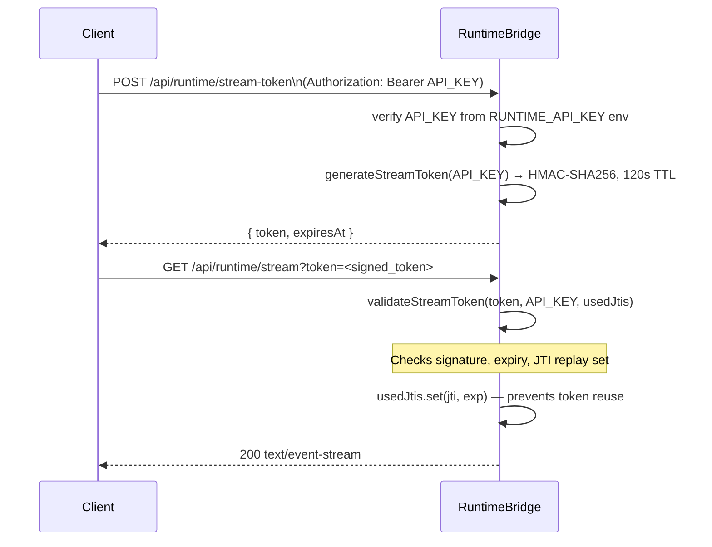

# 08 — RuntimeBridge & API

## Overview

`RuntimeBridge` is the sole external HTTP interface. Runs on port 3001 (configurable), accepts REST and SSE connections, forwards runtime events to connected clients.

File: `runtime/src/bridge/RuntimeBridge.ts`

---

## Configuration

```typescript
interface RuntimeBridgeConfig {
  port?: number;              // default 3001; RUNTIME_PORT env var
  path?: string;              // SSE path; default '/api/runtime/stream'
  heartbeatIntervalMs?: number;  // default 15000
  maxConnections?: number;    // default 50
  corsOrigin?: string;        // default '*' (dev) or '' (prod); CORS_ORIGIN env
  maxBodyBytes?: number;      // default 262144 (256 KB)
  rateLimitMax?: number;      // default 100; RATE_LIMIT_MAX env
  rateLimitWindowMs?: number; // default 60000; RATE_LIMIT_WINDOW_MS env
}
```

---

## Endpoint catalog

All endpoints except `/health` require authentication when `RUNTIME_API_KEY` is set.

| Method | Path | Auth | Description |
|---|---|---|---|
| `GET` | `/health` | None | Basic liveness check; rate-limit exempt |
| `GET` | `/metrics` | Bearer | Process metrics + runtime snapshot |
| `GET` | `/api/runtime/stream` | Bearer or `?token=` | SSE event stream |
| `POST` | `/api/runtime/stream-token` | Bearer | Issue short-lived SSE stream token |
| `GET` | `/api/runtime/snapshot` | Bearer | Full runtime state snapshot |
| `GET` | `/api/runtime/search?q=` | Bearer | Global search across agents and tasks |
| `GET` | `/api/runtime/memory?key=` | Bearer | Read a shared memory key |
| `POST` | `/api/runtime/memory` | Bearer | Write a shared memory key |
| `POST` | `/api/runtime/chat` | Bearer | Single-turn AI chat via provider chain |
| `GET` | `/api/ai/routing` | Bearer | AI provider health and metrics |
| `POST` | `/api/runtime/approve` | Bearer | Approve or reject a workflow approval step |
| `OPTIONS` | `*` | None | CORS preflight |

---

## Endpoint details

### GET /health
```json
{ "status": "ok" }
```
No auth. Rate-limit exempt. Used by process monitors.

### GET /metrics
```json
{
  "uptime": 1234.5,
  "cpuPercent": 2.3,
  "memory": { "rss": ..., "heapUsed": ..., "heapTotal": ..., "external": ... },
  "connections": 3,
  "snapshot": { ... }
}
```

### GET /api/runtime/snapshot
```json
{ "dashboard": {...}, "context": {...}, "kernel": {...}, "observability": {...} }
```

### GET /api/runtime/search?q=
```json
[
  { "category": "Agents", "label": "ResearchAgent", "subtitle": "Agent — running" },
  { "category": "Tasks", "label": "Research on X", "subtitle": "Task — completed · agent_01" }
]
```
Searches agent states and execution history (last 50 records). Returns `[]` for empty `q`.

### GET /api/runtime/memory?key= / POST /api/runtime/memory
GET response: `{ "key": "my.key", "value": <any> }`
POST body: `{ "key": "my.key", "value": <any> }` → `{ "success": true }`

### POST /api/runtime/chat
Request: `{ "messages": [{ "role": "user", "content": "..." }], "system": "optional" }`
Response: `{ "response": "...", "provider": "ninerouter", "model": "...", "latencyMs": 234 }`

Routes through AIService with `preferredProvider: 'ninerouter'`. Falls back through provider chain.

### GET /api/ai/routing
```json
{
  "health": { "ninerouter": { "isAvailable": true, "health": "healthy" }, ... },
  "metrics": { "requestsTotal": 42, "failoverCount": 1, ... },
  "timestamp": "..."
}
```

### POST /api/runtime/stream-token
Response: `{ "token": "...", "expiresAt": "..." }`
When `RUNTIME_API_KEY` not set: `{ "token": null, "expiresAt": null, "mode": "open" }`

### POST /api/runtime/approve
Body: `{ "workflowId": "wf_...", "stepId": "step_...", "approved": true }`
Response: `{ "success": true, "workflowId": "...", "stepId": "...", "approved": true }`

Publishes `checkpoint.approved` event. WorkflowEngine's approval step settles from this event.

---

## Authentication flow



If `RUNTIME_API_KEY` is not set, all endpoints are open. Default in development.

---

## StreamTokenManager

File: `runtime/src/bridge/StreamTokenManager.ts`

| Property | Value |
|---|---|
| Algorithm | HMAC-SHA256 |
| Secret | `RUNTIME_API_KEY` env var |
| TTL | 120 seconds |
| Replay protection | JTI stored in `Map<jti, exp>` |
| JTI cleanup | Every 60 seconds via `cleanupExpiredJtis()` |

Tokens are single-use. Once validated, JTI is added to the replay-protection map.

---

## SSE stream protocol

1. Client connects with valid token.
2. Server sends `event: connected` with `{ clientId, timestamp }`.
3. Server sends `event: snapshot` with current runtime state.
4. Server forwards all runtime events as `event: event` frames.
5. Server sends `event: heartbeat` every 15 seconds with `{ connectedClients, kernel, uptimeMs }`.

Frame format:
```
event: <type>
data: <JSON>

```

Max 50 connections. Connection 51+ receives `429 Too many connections`.

---

## Rate limiting

Per-IP sliding window. Default: 100 req/60s. `/health` exempt.
Buckets cleaned up every `rateLimitWindowMs` to prevent unbounded growth.

---

## Security headers (every response)

```
X-Content-Type-Options: nosniff
X-Frame-Options: DENY
X-XSS-Protection: 1; mode=block
Referrer-Policy: strict-origin-when-cross-origin
Content-Security-Policy: default-src 'none'; frame-ancestors 'none'
X-Request-Id: <uuid>
X-Trace-Id: <from W3C traceparent or new uuid>
```

W3C `traceparent` header is parsed for trace propagation. New trace ID generated if absent.

---

## Request body limits

Max 256 KB. Exceeded → `413 { "error": "Request body too large" }` + `req.destroy()`. All `end` event handlers guard with `if (res.headersSent) return` to prevent double-response (V-03 fix).
