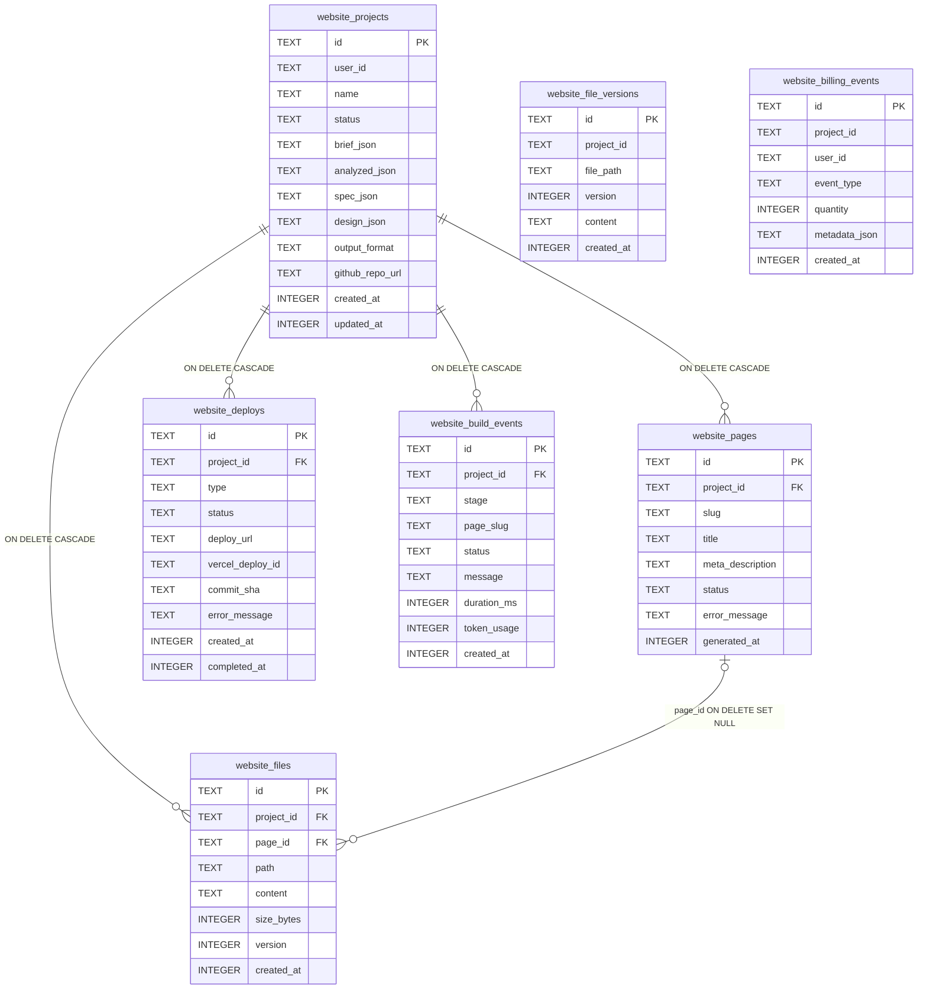

# Website Builder — Database Schema

All 7 tables. SQLite, WAL mode, `foreign_keys = ON`.

## Notes

**`website_file_versions` has no FK** — intentional PRD design. Composite identifier `(project_id, file_path)` used instead of FK to `website_files`. Consequence: deleting a `website_files` row does **not** cascade to `website_file_versions`; M2 application code must clean up version rows explicitly on file or project delete.

**`website_billing_events.project_id`** — no FK constraint. Billing records are retained even if the project is deleted.

**`website_pages |o--o{ website_files`** — `page_id` is nullable (`ON DELETE SET NULL`). A file belongs to zero or one pages. Deleting a page nulls `page_id` on all its files; the files themselves are not deleted.

## Indexes

| Index | Table | Columns |
|-------|-------|---------|
| `idx_website_projects_user_id` | `website_projects` | `user_id` |
| `idx_website_projects_user_status` | `website_projects` | `user_id, status` |
| `idx_website_pages_project_id` | `website_pages` | `project_id` |
| `idx_website_files_project_id` | `website_files` | `project_id` |
| `idx_website_file_versions_project` | `website_file_versions` | `project_id, file_path` |
| `idx_website_deploys_project_id` | `website_deploys` | `project_id` |
| `idx_website_build_events_project_id` | `website_build_events` | `project_id` |
| `idx_website_billing_events_user_id` | `website_billing_events` | `user_id` |

## Unique Constraints

| Table | Columns |
|-------|---------|
| `website_pages` | `(project_id, slug)` |
| `website_files` | `(project_id, path)` |
| `website_file_versions` | `(project_id, file_path, version)` |
